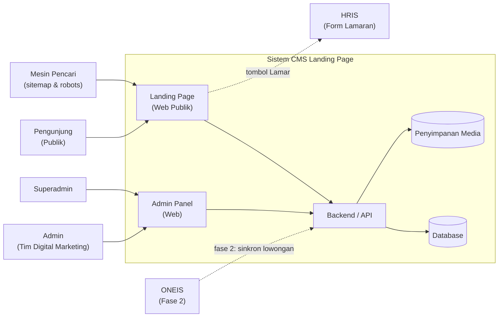
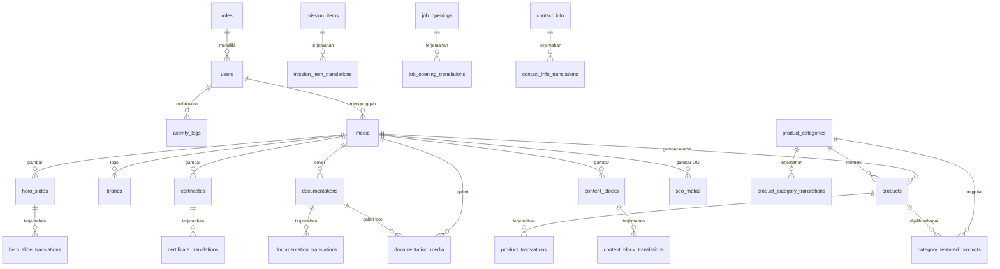
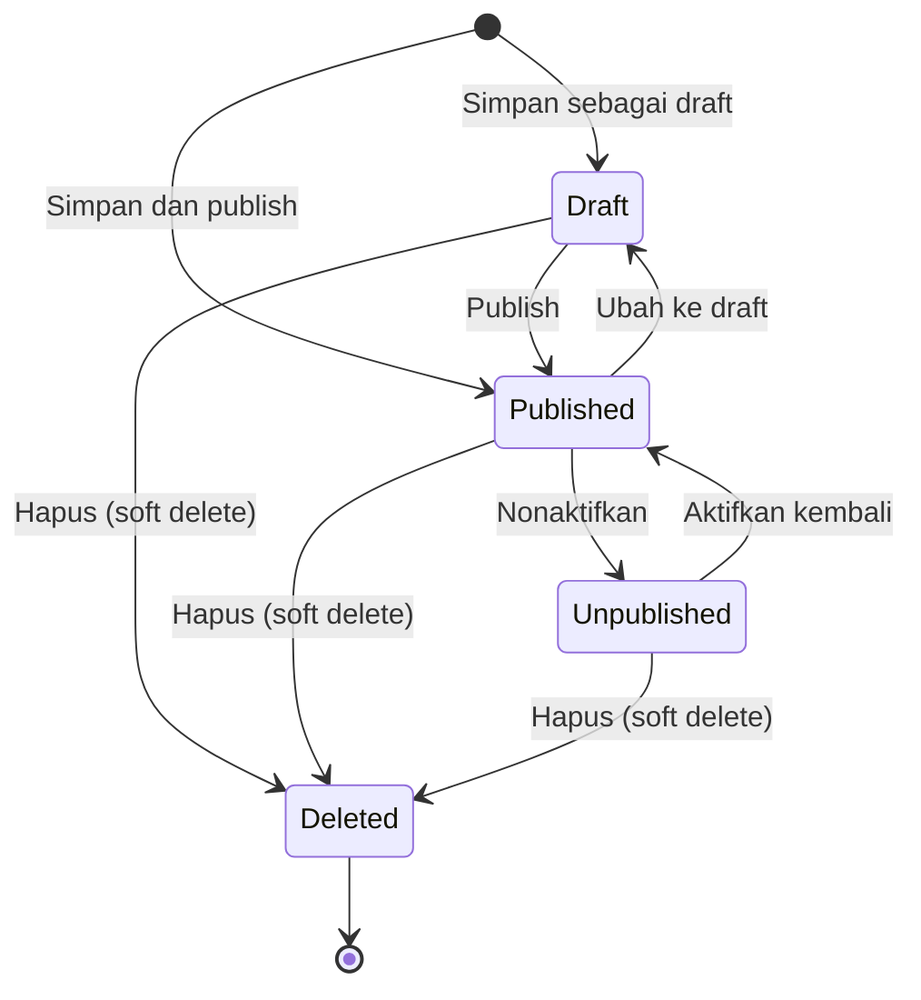
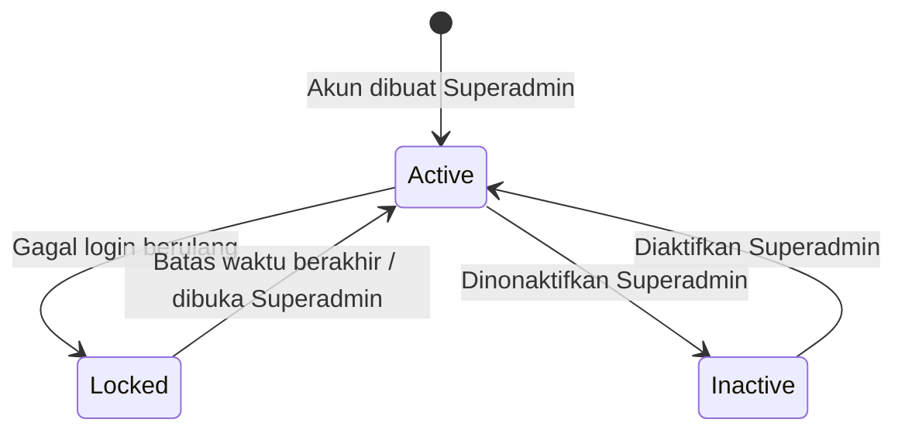

# Functional Specification Document (FSD)
## Content Management System (CMS) Landing Page Company Profile


| Item | Keterangan |
| --- | --- |
| Nama Dokumen | FSD – CMS Landing Page Company Profile |
| Dokumen Acuan | BRD – CMS Landing Page Company Profile v0.1 (disetujui) |
| Versi | 0.1 (Draft) |
| Tanggal | 11 November 2026 |
| Penyusun | Hosea Leonardo – IT Business & System Analyst |
| Pemilik Proses | Tim Digital Marketing |
| Pengembang | Tim IT Development (in-house) |
| Status | Draft – Menunggu Review |


### Riwayat Dokumen


| Versi | Tanggal | Penulis | Perubahan |
| --- | --- | --- | --- |
| 0.1 | 11 Nov 2026 | Hosea Leonardo | Draft awal |


### Daftar Isi


## 1. Introduction


### 1.1 Document Purpose

Dokumen ini menjabarkan spesifikasi fungsional sistem CMS Landing Page Company Profile, yaitu admin panel yang memungkinkan Tim Digital Marketing mengelola konten landing page secara mandiri tanpa coding, serta landing page yang menampilkan konten secara dinamis dari database.
FSD ini diturunkan dari BRD yang telah disetujui dan digunakan sebagai acuan oleh:
Tim IT Development untuk perancangan dan pengembangan sistem.
Tim Digital Marketing untuk memvalidasi bahwa perilaku sistem sesuai kebutuhan.
Tim QA/UAT untuk menyusun skenario pengujian dan kriteria penerimaan.
Ruang lingkup dokumen mengikuti BRD, yaitu enam menu landing page (Beranda, Tentang, Produk, Dokumentasi, Karir, Kontak), admin panel, manajemen media, SEO, dukungan dua bahasa pada landing page (Indonesia dan Inggris), manajemen user dengan dua role, dan log aktivitas.

### 1.2 Glossary & Acronyms


| Istilah | Definisi |
| --- | --- |
| BRD / FSD | Business Requirement Document / Functional Specification Document |
| CMS | Content Management System; di dokumen ini merujuk pada admin panel |
| Admin Panel | Antarmuka web internal untuk mengelola konten landing page |
| Landing Page | Situs publik company profile yang diakses pengunjung |
| Superadmin | Role dengan akses penuh, termasuk manajemen user dan log aktivitas |
| Admin | Role untuk anggota Tim Digital Marketing, mengelola konten |
| Pengunjung | Pengguna publik yang mengakses landing page tanpa login |
| Section | Bagian pada sebuah halaman landing page |
| Konten | Data yang ditampilkan di landing page (teks, gambar, produk, artikel, dll.) |
| Draft / Published / Unpublished | Status konten: belum tayang / tayang / ditarik dari tayangan |
| Soft Delete | Penghapusan dengan menandai data sebagai terhapus (deleted_at) |
| Slug | Bagian URL yang ramah dibaca dan SEO, mis. /produk/pemeriksaan-darah |
| Fallback Bahasa | Menampilkan versi bahasa default (Indonesia) bila terjemahan belum tersedia |
| RBAC | Role-Based Access Control |
| SEO | Search Engine Optimization |
| CTA | Call to Action |
| HRIS | Human Resource Information System; tempat form lamaran saat ini |
| ONEIS | Platform internal perusahaan; integrasi lowongan direncanakan pada fase 2 |
| ERD | Entity Relationship Diagram |
| UAT | User Acceptance Test |
| DoD | Definition of Done |
| BPMN | Business Process Model and Notation 2.0 |


### 1.3 Assumptions & Constraints


### Asumsi


| ID | Asumsi |
| --- | --- |
| AS-01 | Konten landing page diisi dalam dua bahasa (Indonesia dan Inggris). Bahasa Indonesia adalah bahasa default dan wajib diisi; bahasa Inggris opsional (fallback ke Indonesia). |
| AS-02 | Admin panel hanya tersedia dalam bahasa Indonesia. |
| AS-03 | Hanya ada dua role: Superadmin dan Admin (Tim Digital Marketing). |
| AS-04 | Tidak ada alur approval. Admin dapat mempublikasikan konten secara langsung. |
| AS-05 | Hero/Banner: bila ada satu slide aktif ditampilkan sebagai gambar tunggal, bila lebih dari satu ditampilkan sebagai slider. |
| AS-06 | Jangkauan Kami pada fase 1 berupa gambar. Struktur data wilayah disiapkan untuk peta interaktif (Leaflet) pada fase 2. |
| AS-07 | Menu Karir pada fase 1 berupa template lowongan yang dikelola di CMS. Tombol “Lamar” mengarah ke form lamaran di HRIS. |
| AS-08 | Pada menu Produk, tab “Semua” menampilkan produk unggulan (maksimal 6) untuk setiap kategori. Tab kategori tertentu menampilkan maksimal 6 produk unggulan kategori tersebut. Tombol “Lihat Semua Produk” menuju halaman daftar produk lengkap dengan filter kategori dan paginasi. |
| AS-09 | Lama perusahaan berdiri dihitung otomatis dari tahun berdiri yang diinput admin, sehingga selalu mutakhir. |
| AS-10 | Menu Kontak hanya menampilkan informasi kontak, lokasi, dan email yang dikelola di CMS. Tidak ada form kirim pesan dari pengunjung. |
| AS-11 | Marketing automation belum memiliki kebutuhan fitur pada saat ini sehingga tidak dispesifikasikan dalam FSD ini. |
| AS-12 | Penghapusan konten bersifat soft delete. Pemulihan data dilakukan oleh Tim IT atas permintaan (tidak ada fitur restore di UI pada rilis awal). |


### Batasan (Constraints)


| ID | Batasan |
| --- | --- |
| CN-01 | Pengembangan dilakukan in-house oleh Tim IT Development. |
| CN-02 | Landing page hanya membaca data yang berstatus Published dan tidak terhapus. |
| CN-03 | Seluruh perubahan konten harus tercatat di log aktivitas. |
| CN-04 | Integrasi ONEIS (lowongan otomatis) dan peta Leaflet bukan bagian rilis awal (fase 2). |
| CN-05 | Form lamaran dan data pelamar tetap berada di HRIS, tidak diproses oleh sistem ini. |


#### 1.3.1 Open Decisions


| ID | Keputusan yang Perlu Ditetapkan | Pemilik | Status |
| --- | --- | --- | --- |
| OD-01 | Teknologi (stack) backend, frontend, dan database yang digunakan | Tim IT Development | Open |
| OD-02 | Metode rendering landing page (server-side rendering atau memanggil API dari browser) dengan mempertimbangkan SEO | Tim IT Development | Open |
| OD-03 | Lokasi hosting dan penyimpanan media (server lokal atau object storage) | Tim IT Development | Open |
| OD-04 | Fitur SEO lanjutan di luar BR-26 (mis. schema markup, redirect manager) | Tim Digital Marketing | Open |
| OD-05 | Apakah penjadwalan publikasi (BR-13, Could Have) dimasukkan ke rilis awal | Tim Digital Marketing | Open |
| OD-06 | Apakah Admin boleh melihat log aktivitas miliknya sendiri (asumsi: hanya Superadmin yang dapat melihat log) | Tim Digital Marketing | Open |
| OD-07 | Fase 2: lowongan yang boleh tampil publik dan lokasi form lamaran (HRIS atau ONEIS) | Tim HR / Tim IT | Open |
| OD-08 | Batas ukuran file upload final (asumsi: gambar maksimal 2 MB) | Tim IT Development | Open |


## 2. System Architecture & Context


### 2.1 Context Diagram





### 2.2 Interacting System


| No | Sistem / Aktor | Jenis | Interaksi | Arah | Fase |
| --- | --- | --- | --- | --- | --- |
| 1 | Admin (Tim Digital Marketing) | Aktor internal | Mengelola konten melalui Admin Panel | Admin Panel ↔ Backend | 1 |
| 2 | Superadmin | Aktor internal | Mengelola user, role, melihat log, dan mengelola konten | Admin Panel ↔ Backend | 1 |
| 3 | Pengunjung | Aktor eksternal | Mengakses landing page (baca saja) | Landing Page ← Backend | 1 |
| 4 | Database | Komponen internal | Menyimpan seluruh konten, user, dan log | Backend ↔ Database | 1 |
| 5 | Penyimpanan Media | Komponen internal | Menyimpan file gambar | Backend ↔ Storage | 1 |
| 6 | HRIS | Sistem internal | Landing page menyediakan tautan (link out) ke form lamaran | Landing Page → HRIS | 1 |
| 7 | Mesin Pencari | Sistem eksternal | Membaca sitemap.xml, robots.txt, dan meta SEO | Mesin Pencari ← Landing Page | 1 |
| 8 | ONEIS | Sistem internal | Mengirim lowongan yang diposting HR untuk tampil otomatis | ONEIS → Backend | 2 |


## 3. Global Data & Security Model


### 3.1 Entity Relationship Diagram and Schema


#### 3.1.1 ERD




Tabel company_summary, brands, social_links, coverage_regions, dan seo_metas berdiri sendiri (relasi hanya ke media bila ada).

#### 3.1.2 Konvensi Skema

Kolom standar pada seluruh tabel konten: id (BIGINT, PK, auto increment), created_at, updated_at (TIMESTAMP), created_by, updated_by (BIGINT, FK → users.id), dan deleted_at (TIMESTAMP, null; soft delete).
Status konten (status): draft, published, unpublished (lihat 3.3.1).
Urutan tampil (display_order): INT, mulai dari 1; nilai lebih kecil tampil lebih dulu.
Tabel terjemahan (*_translations): berisi `<entitas>_id`, lang (CHAR(2): id atau en), serta kolom teks. Unique pada (<entitas>_id, lang). Baris id wajib ada; baris en opsional.
Tipe data bersifat logis dan akan disesuaikan dengan teknologi yang dipilih (OD-01).

#### 3.1.3 Daftar Tabel


#### T01 – roles


| Kolom | Tipe | Keterangan |
| --- | --- | --- |
| id | BIGINT PK | — |
| name | VARCHAR(30) UNIQUE | superadmin atau admin |
| description | VARCHAR(150) | Deskripsi role |


#### T02 – users


| Kolom | Tipe | Keterangan |
| --- | --- | --- |
| id | BIGINT PK | — |
| name | VARCHAR(100) | Nama lengkap, wajib |
| email | VARCHAR(150) UNIQUE | Digunakan untuk login |
| password_hash | VARCHAR(255) | Hash password (bukan teks asli) |
| role_id | BIGINT FK | → roles.id |
| status | ENUM | active, inactive, locked |
| failed_login_count | INT | Default 0 |
| locked_until | TIMESTAMP NULL | Batas waktu kunci akun |
| last_login_at | TIMESTAMP NULL | — |
| created_at, updated_at, deleted_at | TIMESTAMP | — |


#### T03 – media


| Kolom | Tipe | Keterangan |
| --- | --- | --- |
| id | BIGINT PK | — |
| file_name | VARCHAR(255) | Nama file tersimpan (unik) |
| original_name | VARCHAR(255) | Nama file asli |
| path | VARCHAR(500) | Lokasi penyimpanan |
| mime_type | VARCHAR(50) | image/jpeg, image/png, image/webp |
| size_bytes | INT | Ukuran file |
| width, height | INT | Dimensi piksel |
| alt_text_id, alt_text_en | VARCHAR(200) | Teks alternatif (SEO dan aksesibilitas) |
| uploaded_by | BIGINT FK | → users.id |
| created_at, deleted_at | TIMESTAMP | — |


#### T04 – content_blocks (blok konten tunggal per section)


| Kolom | Tipe | Keterangan |
| --- | --- | --- |
| id | BIGINT PK | — |
| block_key | VARCHAR(50) UNIQUE | home_coverage, home_cta, about_company, about_vision, footer_about, career_intro |
| media_id | BIGINT FK NULL | → media.id |
| cta_url | VARCHAR(500) NULL | Tujuan tombol (bila ada) |
| status | ENUM | draft, published, unpublished |
| kolom standar | — | — |


#### T05 – content_block_translations


| Kolom | Tipe | Keterangan |
| --- | --- | --- |
| content_block_id | BIGINT FK | → content_blocks.id |
| lang | CHAR(2) | id / en |
| title | VARCHAR(200) NULL | — |
| subtitle | VARCHAR(300) NULL | — |
| body | TEXT NULL | Teks (rich text terbatas, disanitasi) |
| cta_label | VARCHAR(60) NULL | Label tombol |


#### T06 – hero_slides dan T07 – hero_slide_translations


| Kolom | Tipe | Keterangan |
| --- | --- | --- |
| id | BIGINT PK | — |
| media_id | BIGINT FK | Gambar banner, wajib |
| cta_url | VARCHAR(500) NULL | — |
| display_order | INT | — |
| status | ENUM | draft, published, unpublished |
| (translations) title, subtitle, cta_label | VARCHAR | Per bahasa |


#### T08 – brands (Brand Kami)


| Kolom | Tipe | Keterangan |
| --- | --- | --- |
| id | BIGINT PK | — |
| name | VARCHAR(100) | Nama brand, wajib |
| logo_media_id | BIGINT FK | Logo, wajib |
| website_url | VARCHAR(500) NULL | display_order, status |


#### T09 – mission_items dan T10 – mission_item_translations (poin misi)


| Kolom | Tipe | Keterangan |
| --- | --- | --- |
| id, display_order, status | (translations) text | VARCHAR(500) |
| Isi poin misi per bahasa | — | — |


#### T11 – company_summary (satu baris)


| Kolom | Tipe | Keterangan |
| --- | --- | --- |
| id | BIGINT PK | — |
| established_year | SMALLINT | Tahun berdiri; lama berdiri dihitung otomatis |
| partner_count | INT | Jumlah mitra |
| province_count | INT | Jumlah jangkauan provinsi |
| updated_by, updated_at | — | — |


#### T12 – certificates dan T13 – certificate_translations (Sertifikat dan Penghargaan)


| Kolom | Tipe | Keterangan |
| --- | --- | --- |
| id | BIGINT PK | — |
| media_id | BIGINT FK | Gambar sertifikat/penghargaan |
| issued_year | SMALLINT NULL | Tahun diterbitkan |
| display_order, status | (translations) title, description | VARCHAR / TEXT |


#### T14 – product_categories dan T15 – product_category_translations


| Kolom | Tipe | Keterangan |
| --- | --- | --- |
| id, display_order, status | (translations) name, slug | VARCHAR |
| Nama kategori pemeriksaan dan slug unik per bahasa | — | — |


#### T16 – products dan T17 – product_translations


| Kolom | Tipe | Keterangan |
| --- | --- | --- |
| id | BIGINT PK | — |
| category_id | BIGINT FK | → product_categories.id, wajib |
| media_id | BIGINT FK | Gambar utama produk |
| display_order | INT | Urutan dalam kategori |
| status | ENUM | draft, published, unpublished |
| (translations) name, slug, description | VARCHAR / TEXT | Slug unik per bahasa |


#### T18 – category_featured_products (6 produk yang tampil per kategori)


| Kolom | Tipe | Keterangan |
| --- | --- | --- |
| id | BIGINT PK | — |
| category_id | BIGINT FK | — |
| product_id | BIGINT FK | Produk harus milik kategori yang sama |
| display_order | INT | Urutan tampil (1–6) |
| UNIQUE (category_id, product_id); maksimal 6 baris per kategori (aturan BL-12) | — | — |


#### T19 – documentations, T20 – documentation_translations, T21 – documentation_media


| Kolom | Tipe | Keterangan |
| --- | --- | --- |
| id | BIGINT PK | — |
| type | ENUM | article atau activity (foto kegiatan) |
| cover_media_id | BIGINT FK | Gambar sampul |
| event_date | DATE | Tanggal artikel/kegiatan |
| status | ENUM | draft, published, unpublished |
| (translations) title, slug, excerpt, body | Slug unik per bahasa | (documentation_media) documentation_id, media_id, caption_id, caption_en, display_order |
| Galeri gambar; satu artikel/kegiatan dapat memiliki banyak gambar (relasi 1 ke banyak) | — | — |


#### T22 – job_openings dan T23 – job_opening_translations


| Kolom | Tipe | Keterangan |
| --- | --- | --- |
| id | BIGINT PK | — |
| employment_type | VARCHAR(50) | Mis. Full-time, Kontrak |
| location | VARCHAR(150) | Lokasi penempatan |
| posted_at | DATE | — |
| closing_date | DATE NULL | — |
| apply_url | VARCHAR(500) | Link form lamaran di HRIS |
| status | ENUM | open, closed, draft |
| source | ENUM | manual (fase 1), oneis (fase 2) |
| external_ref | VARCHAR(100) NULL | ID lowongan di ONEIS (fase 2) |
| (translations) title, description, requirements | — | — |


#### T24 – contact_info (satu baris) dan T25 – contact_info_translations


| Kolom | Tipe | Keterangan |
| --- | --- | --- |
| id | BIGINT PK | — |
| phone | VARCHAR(30) | Nomor telepon |
| email | VARCHAR(150) | Email perusahaan |
| maps_url | VARCHAR(500) NULL | Link lokasi (Google Maps) |
| latitude, longitude | DECIMAL NULL | Koordinat (disiapkan untuk peta) |
| (translations) address, office_hours | TEXT / VARCHAR | Alamat dan jam operasional per bahasa |


#### T26 – social_links (Footer)


| Kolom | Tipe | Keterangan |
| --- | --- | --- |
| id | BIGINT PK | — |
| platform | VARCHAR(30) | Instagram, LinkedIn, dll. |
| url | VARCHAR(500) | display_order, status |


#### T27 – coverage_regions (disiapkan untuk Leaflet, fase 2; belum ditampilkan di fase 1)


| Kolom | Tipe | Keterangan |
| --- | --- | --- |
| id | BIGINT PK | — |
| province_code | VARCHAR(10) UNIQUE | Kode wilayah |
| province_name | VARCHAR(100) | — |
| is_covered | TINYINT(1) | Provinsi dijangkau atau tidak |
| latitude, longitude | DECIMAL | Titik pusat |
| note | VARCHAR(300) NULL | Keterangan popup |


#### T28 – seo_metas


| Kolom | Tipe | Keterangan |
| --- | --- | --- |
| id | BIGINT PK | — |
| page_key | VARCHAR(50) | home, about, products, documentation, career, contact |
| lang | CHAR(2) | id / en |
| meta_title | VARCHAR(70) | — |
| meta_description | VARCHAR(160) | — |
| canonical_url | VARCHAR(500) NULL | — |
| og_media_id | BIGINT FK NULL | Gambar Open Graph |
| robots_index | TINYINT(1) | Default 1 |
| UNIQUE (page_key, lang) | — | — |


SEO untuk produk dan dokumentasi menggunakan title, slug, excerpt/description, dan gambar dari entitas masing-masing, serta alt_text pada media.

#### T29 – activity_logs


| Kolom | Tipe | Keterangan |
| --- | --- | --- |
| id | BIGINT PK | — |
| user_id | BIGINT FK NULL | Pelaku |
| action | VARCHAR(30) | login, logout, login_failed, create, update, delete, publish, unpublish, reorder, upload |
| entity_type | VARCHAR(50) | Nama tabel/entitas |
| entity_id | BIGINT NULL | — |
| old_values, new_values | JSON NULL | Nilai sebelum dan sesudah (tanpa data sensitif) |
| ip_address | VARCHAR(45) | — |
| user_agent | VARCHAR(300) | — |
| created_at | TIMESTAMP | Log bersifat append-only (tidak dapat diubah/dihapus dari UI) |


### 3.2 Actor & Permission Matrix (RBAC)

Keterangan: C = Create, R = Read, U = Update, D = Delete, P = Publish/Unpublish, ✖ = tidak ada akses.

| Modul / Fungsi | Superadmin | Admin (Digital Marketing) | Pengunjung |
| --- | --- | --- | --- |
| Login ke Admin Panel | ✔ | ✔ | ✖ |
| Dashboard | R | R | ✖ |
| Beranda: Hero/Banner, Jangkauan Kami, CTA, Brand | C R U D P | C R U D P | R (published) |
| Tentang: Perusahaan, Visi & Misi, Summary, Sertifikat | C R U D P | C R U D P | R (published) |
| Produk: Kategori, Produk, Produk Unggulan | C R U D P | C R U D P | R (published) |
| Dokumentasi: Artikel dan Foto Kegiatan | C R U D P | C R U D P | R (published) |
| Karir: Lowongan | C R U D P | C R U D P | R (open) |
| Kontak, Sosial Media, Footer | R U | R U | R |
| Media Library | C R U D | C R U D | ✖ |
| Pengaturan SEO | R U | R U | R (meta di halaman) |
| Manajemen User dan Role | C R U D | ✖ | ✖ |
| Log Aktivitas | R | ✖ (OD-06) | ✖ |
| Ubah password sendiri | U | U | ✖ |


Aturan keamanan akses: 1. Setiap request ke Admin API wajib terautentikasi dan lolos pemeriksaan role di sisi server (bukan hanya menyembunyikan menu). 2. Superadmin tidak dapat menghapus atau menonaktifkan akunnya sendiri, dan sistem harus selalu memiliki minimal satu Superadmin aktif. 3. Konten berstatus draft, unpublished, atau terhapus tidak pernah dikirim ke Public API.

### 3.3 Global Status Model (State Machine)


#### 3.3.1 Status Konten (Hero, Brand, Misi, Sertifikat, Kategori, Produk, Dokumentasi, Blok Konten, Sosial Media)





| Status | Tampil di Landing Page | Dapat Diedit | Keterangan |
| --- | --- | --- | --- |
| Draft | Tidak | Ya | Belum siap tayang |
| Published | Ya | Ya (perubahan langsung tayang) | Tayang realtime |
| Unpublished | Tidak | Ya | Ditarik sementara tanpa dihapus |
| Deleted | Tidak | Tidak | Soft delete, hanya dapat dipulihkan oleh Tim IT |


#### 3.3.2 Status Akun User





#### 3.3.3 Status Lowongan (Karir)


| Status | Tampil di Landing Page | Keterangan |
| --- | --- | --- |
| Draft | Tidak | Belum dipublikasikan |
| Open | Ya, dengan tombol Lamar | Lowongan dibuka |
| Closed | Tidak (atau ditandai “Ditutup”, sesuai konfigurasi) | Lowongan ditutup manual atau otomatis setelah closing_date terlewati |


#### 3.3.4 Status Media


| Status | Keterangan |
| --- | --- |
| Active | File dapat dipilih dan digunakan pada konten |
| Deleted | Soft delete. Hanya dapat dilakukan bila media tidak sedang dipakai konten manapun (BL-17) |


#### 3.3.5 Policy and Workflow

Tanpa approval. Admin yang berwenang dapat langsung mempublikasikan konten (sesuai keputusan BRD).
Perubahan langsung tayang. Perubahan pada konten berstatus Published langsung terlihat di landing page setelah disimpan (cache dibersihkan otomatis, BL-19).
Preview. Konten draft dapat dipratinjau oleh user admin yang sedang login sebelum dipublikasikan.
Soft delete. Konten yang dihapus tidak benar-benar dihilangkan dari database. Penghapusan selalu meminta konfirmasi.
Audit trail. Setiap aksi tambah, ubah, hapus, publish, nonaktifkan, urutkan, upload, dan login tercatat di activity_logs.
Bahasa. Konten bahasa Indonesia wajib diisi sebelum dapat dipublikasikan. Bahasa Inggris opsional dengan fallback ke Indonesia.
Keamanan akun. Akun terkunci sementara setelah percobaan login gagal berulang (BL-02). Password disimpan dalam bentuk hash.
Retensi. Log aktivitas disimpan minimal 12 bulan (usulan, dikonfirmasi). Data soft delete disimpan sampai ada kebijakan pembersihan dari Tim IT.


## 4. Functional Specification: Content Management Landing Page


### 4.1 Module Overview & Process Flow

Sistem terdiri atas modul-modul berikut, yang seluruhnya mengikuti pola kerja yang sama (kelola di Admin Panel → simpan di database → tampil dinamis di landing page).
Kode

| Modul | Menu Landing Page | Referensi BR | M01 |
| --- | --- | --- | --- |
| Autentikasi dan Manajemen User | – | BR-01, BR-09 | — |
| M02 | Beranda (Hero, Jangkauan Kami, CTA, Brand) | Beranda | BR-02, BR-15, BR-22 |
| M03 | Tentang (Perusahaan, Visi & Misi, Summary, Sertifikat) | Tentang | BR-02, BR-16 |
| M04 | Produk (Kategori, Produk, Produk Unggulan) | Produk | BR-04, BR-17, BR-18 |
| M05 | Dokumentasi (Artikel dan Foto Kegiatan) | Dokumentasi | BR-19 |
| M06 | Karir (Template Lowongan) | Karir | BR-23 |
| M07 | Kontak dan Footer | Kontak, Footer | BR-20, BR-21 |
| M08 | Media Library | Seluruh menu | BR-06 |
| M09 | SEO | Seluruh menu | BR-26 |
| M10 | Multi-bahasa | Seluruh menu | BR-28 |
| M11 | Log Aktivitas dan Dashboard | – | BR-10 |
| M12 | Landing Page Dinamis | Seluruh menu | BR-03, BR-05, BR-14 |


#### 4.1.1 End to End Process Map (As-Is dan To-Be)


### A. Kondisi Saat Ini (As-Is)


**Alur proses As-Is (BPMN 2.0)**

*Gambar 1. Alur proses As-Is (BPMN 2.0). File sumber: BPMN-AS-IS.bpmn*

| No | Aktivitas | PIC | Permasalahan |
| --- | --- | --- | --- |
| 1 | Menyiapkan konten baru | Tim Digital Marketing | – |
| 2 | Mengirim request perubahan ke Tim IT | Tim Digital Marketing | Bergantung pada antrean dan prioritas Tim IT |
| 3 | Menganalisis request | Tim IT Development | Perubahan kecil tetap memerlukan analisis |
| 4 | Mengubah kode program landing page | Tim IT Development | Konten tertanam di kode (static) sehingga setiap perubahan perlu coding |
| 5 | Testing dan deployment | Tim IT Development | Setiap perubahan memerlukan proses release |
| 6 | Verifikasi hasil | Tim Digital Marketing | Revisi kecil mengulang seluruh proses |


### B. Kondisi yang Diharapkan (To-Be)


**Alur proses To-Be (BPMN 2.0)**

*Gambar 2. Alur proses To-Be (BPMN 2.0). File sumber: BPMN-TO-BE.bpmn*

| No | Aktivitas | PIC | Fungsi Sistem | Referensi |
| --- | --- | --- | --- | --- |
| 1 | Login ke Admin Panel | Admin | Autentikasi email dan password | SCR-01, BL-01 s.d. BL-04 |
| 2 | Validasi akun dan hak akses | Sistem | Memeriksa status akun dan role | 3.2, BL-24 |
| 3 | Memilih menu dan section konten | Admin | Navigasi menu admin | 4.1.2 |
| 4a | Menambah / mengubah konten dan upload media | Admin | Form konten dua bahasa, upload gambar | SCR-10 s.d. SCR-61, SCR-70 |
| 4b | Preview konten | Admin | Pratinjau tampilan sebelum tayang | BL-28 |
| 4c | Publish konten | Admin | Mengubah status menjadi Published | BL-06, BL-08 |
| 5 | Konfirmasi penghapusan konten (jalur Hapus) | Admin | Dialog konfirmasi, soft delete | BL-11 |
| 6 | Menyimpan ke database dan mencatat log | Sistem | Simpan data, tulis activity_logs, bersihkan cache | BL-19, BL-23 |
| 7 | Landing page menampilkan konten terbaru | Sistem | Public API membaca data Published | M12, LP-01 s.d. LP-07 |


### C. Perbandingan As-Is dan To-Be


| Aspek | As-Is | To-Be |
| --- | --- | --- |
| Pembuatan konten | Melalui coding oleh developer | Melalui Admin Panel oleh Tim Digital Marketing |
| Ubah / hapus konten | Tidak dapat langsung, perlu coding | Dapat dilakukan langsung dan cepat |
| Effort tambah 1 konten per section | Tinggi (analisis, coding, testing, deployment) | Rendah (isi form dan publish) |
| Sumber data | Static di kode program | Dinamis dari database |
| Waktu tayang | Menunggu proses release | Realtime setelah publish |
| Ketergantungan ke Tim IT | Tinggi | Hanya untuk perubahan sistem, bukan konten |
| Pengelolaan produk | Menunggu developer | Admin menambah dan memilih 6 produk unggulan per kategori sendiri |
| Jejak perubahan | Tidak ada | Tercatat pada log aktivitas |


#### 4.1.2 Information Architecture (Menu Structure)


### A. Menu dan Section Landing Page


```text
Landing Page (ID / EN)
├── Beranda
│   ├── Hero / Banner (satu gambar atau slider)
│   ├── Jangkauan Kami (gambar; peta Leaflet di fase 2)
│   ├── CTA Hubungi Kami
│   ├── Brand Kami
│   └── Footer
├── Tentang
│   ├── Tentang Perusahaan
│   ├── Visi & Misi
│   ├── Summary (lama berdiri, jumlah mitra, jumlah jangkauan provinsi)
│   ├── Sertifikat dan Penghargaan
│   └── Footer
├── Produk
│   ├── Temukan Produk Kami (tab kategori pemeriksaan, default "Semua")
│   ├── Produk per Kategori (maks. 6 per kategori) + CTA "Lihat Semua Produk"
│   └── Halaman Daftar Semua Produk (filter kategori, paginasi)
├── Dokumentasi
│   ├── Artikel (daftar dan halaman detail)
│   └── Foto Kegiatan (galeri)
├── Karir
│   └── Daftar Lowongan (tombol Lamar → HRIS)
└── Kontak
    └── Informasi Kontak (telepon, email, alamat, lokasi)
```


### B. Menu Admin Panel


```text
Admin Panel (Bahasa Indonesia)
├── Dashboard
├── Beranda
│   ├── Hero / Banner
│   ├── Jangkauan Kami
│   ├── CTA Hubungi Kami
│   └── Brand Kami
├── Tentang
│   ├── Tentang Perusahaan
│   ├── Visi & Misi
│   ├── Summary
│   └── Sertifikat dan Penghargaan
├── Produk
│   ├── Kategori Pemeriksaan
│   ├── Daftar Produk
│   └── Produk Unggulan per Kategori
├── Dokumentasi
├── Karir
├── Kontak dan Footer
│   ├── Informasi Kontak
│   └── Sosial Media & Footer
├── Media Library
├── Pengaturan SEO
├── Pengaturan Sistem (khusus Superadmin)
│   ├── Manajemen User
│   └── Log Aktivitas
└── Profil Saya (ubah password, logout)
```


### 4.2 User Interface (UI) & Screen Details


#### 4.2.1 Daftar Layar


| ID | Layar | Aktor | Referensi BR |
| --- | --- | --- | --- |
| SCR-01 | Login | Superadmin, Admin | BR-01 |
| SCR-02 | Dashboard | Superadmin, Admin | BR-10 |
| SCR-03 | Profil Saya (Ubah Password) | Superadmin, Admin | BR-01 |
| SCR-10 / 11 | Hero / Banner: Daftar / Form | Superadmin, Admin | BR-15 |
| SCR-12 | Jangkauan Kami | Superadmin, Admin | BR-15, BR-22 |
| SCR-13 | CTA Hubungi Kami | Superadmin, Admin | BR-15 |
| SCR-14 / 15 | Brand Kami: Daftar / Form | Superadmin, Admin | BR-15 |
| SCR-20 | Tentang Perusahaan | Superadmin, Admin | BR-16 |
| SCR-21 | Visi & Misi | Superadmin, Admin | BR-16 |
| SCR-22 | Summary | Superadmin, Admin | BR-16 |
| SCR-23 / 24 | Sertifikat dan Penghargaan: Daftar / Form | Superadmin, Admin | BR-16 |
| SCR-30 / 31 | Kategori Pemeriksaan: Daftar / Form | Superadmin, Admin | BR-17 |
| SCR-32 / 33 | Produk: Daftar / Form | Superadmin, Admin | BR-04 |
| SCR-34 | Produk Unggulan per Kategori | Superadmin, Admin | BR-18 |
| SCR-40 / 41 | Dokumentasi: Daftar / Form | Superadmin, Admin | BR-19 |
| SCR-50 / 51 | Lowongan Karir: Daftar / Form | Superadmin, Admin | BR-23 |
| SCR-60 | Informasi Kontak | Superadmin, Admin | BR-21 |
| SCR-61 | Sosial Media dan Footer | Superadmin, Admin | BR-20 |
| SCR-70 | Media Library | Superadmin, Admin | BR-06 |
| SCR-71 | Pengaturan SEO | Superadmin, Admin | BR-26 |
| SCR-80 / 81 | Manajemen User: Daftar / Form | Superadmin | BR-09 |
| SCR-82 | Log Aktivitas | Superadmin | BR-10 |
| LP-01 s.d. LP-07 | Halaman Landing Page (publik) | Pengunjung | BR-03, BR-05, BR-14, BR-28 |


#### 4.2.2 Standar UI Umum Admin Panel


| Elemen | Ketentuan |
| --- | --- |
| Layar daftar | Tabel dengan pencarian, filter status, urutan, paginasi (10/25/50 baris). Kolom aksi: Ubah, Aktif/Nonaktif, Hapus. |
| Layar form | Tab bahasa Indonesia dan English. Tombol: Simpan Draft, Simpan & Publish, Preview, Batal. |
| Indikator wajib | Tanda bintang (*) pada field wajib. Validasi dilakukan saat submit dan di sisi server. |
| Status | Label berwarna: Draft (abu-abu), Published (hijau), Unpublished (kuning). |
| Konfirmasi hapus | Dialog: “Apakah Anda yakin ingin menghapus data ini?” dengan tombol Hapus dan Batal. |
| Notifikasi | Pesan sukses/gagal singkat setelah setiap aksi (toast). |
| Urutan | Drag & drop atau tombol naik/turun pada daftar yang memiliki urutan; perubahan tersimpan otomatis dan tercatat di log. |
| Gambar | Dipilih dari Media Library atau diunggah langsung; menampilkan pratinjau dan teks alternatif. |
| Responsif | Admin Panel dapat digunakan pada desktop dan tablet. |


#### 4.2.3 Spesifikasi Layar Admin Panel


#### SCR-01 – Login


| Field | Tipe | Wajib | Validasi |
| --- | --- | --- | --- |
| Email | Teks | Ya | Format email |
| Password | Password (disembunyikan, ada tombol lihat) | Ya | Tidak boleh kosong |


Aksi: Masuk. Berhasil → SCR-02. Gagal → pesan umum “Email atau password salah” (tidak menyebutkan mana yang salah). Akun terkunci/nonaktif → pesan sesuai status (BL-02).

#### SCR-02 – Dashboard: menampilkan ringkasan sesuai bagian 7 (jumlah konten per status, lowongan terbuka, aktivitas terbaru, pintasan “Tambah Produk”, “Tambah Artikel”).


#### SCR-03 – Profil Saya


| Field | Tipe | Wajib | Validasi |
| --- | --- | --- | --- |
| Password lama | Password | Ya | Harus sesuai |
| Password baru | Password | Ya | Sesuai kebijakan BL-03 |
| Konfirmasi password baru | Password | Ya | Harus sama dengan password baru |


#### SCR-10 / SCR-11 – Hero / Banner

SCR-10 (Daftar): kolom pratinjau gambar, judul (ID), status, urutan, aksi. Informasi mode tampilan: “1 slide aktif = gambar tunggal, lebih dari 1 = slider” (BL-09).
SCR-11 (Form):

| Field | Tipe | Wajib | Validasi / Keterangan |
| --- | --- | --- | --- |
| Gambar banner | Media | Ya | Format JPG/PNG/WebP, maks. 2 MB, disarankan rasio lebar (mis. 1920×700 px) |
| Judul (ID / EN) | Teks | ID: Ya | Maks. 120 karakter |
| Subjudul (ID / EN) | Teks | Tidak | Maks. 250 karakter |
| Label tombol CTA (ID / EN) | Teks | Tidak | Maks. 40 karakter |
| Link tombol CTA | URL | Wajib bila label diisi | Link internal (/produk) atau https:// |
| Status | Pilihan | Ya | Draft / Published / Unpublished |


#### SCR-12 – Jangkauan Kami


| Field | Tipe | Wajib | Validasi / Keterangan |
| --- | --- | --- | --- |
| Judul (ID / EN) | Teks | ID: Ya | Maks. 120 karakter |
| Deskripsi (ID / EN) | Teks | Tidak | Maks. 500 karakter |
| Gambar jangkauan | Media | Ya | Fase 1: gambar peta/jangkauan |
| Status | Pilihan | Ya | — |


Catatan: data wilayah (coverage_regions, T27) disiapkan di database, belum memiliki layar pengelolaan di fase 1.

#### SCR-13 – CTA Hubungi Kami


| Field | Tipe | Wajib | Validasi |
| --- | --- | --- | --- |
| Judul (ID / EN) | Teks | ID: Ya | Maks. 120 karakter |
| Teks pendukung (ID / EN) | Teks | Tidak | Maks. 300 karakter |
| Label tombol (ID / EN) | Teks | ID: Ya | Maks. 40 karakter |
| Link tombol | URL | Ya | Link internal (mis. halaman Kontak), https://, atau tautan WhatsApp |
| Status | Pilihan | Ya | — |


#### SCR-14 / SCR-15 – Brand Kami

SCR-14: daftar logo, nama, status, urutan, aksi (tambah, ubah, hapus, urutkan).
SCR-15 (Form):

| Field | Tipe | Wajib | Validasi |
| --- | --- | --- | --- |
| Nama brand | Teks | Ya | Maks. 100 karakter |
| Logo | Media | Ya | JPG/PNG/WebP, maks. 2 MB (disarankan PNG/WebP transparan) |
| Link website | URL | Tidak | https:// |
| Status | Pilihan | Ya | — |


#### SCR-20 – Tentang Perusahaan


| Field | Tipe | Wajib | Validasi |
| --- | --- | --- | --- |
| Judul (ID / EN) | Teks | ID: Ya | Maks. 120 karakter |
| Isi (ID / EN) | Rich text terbatas | ID: Ya | Maks. 3000 karakter; tag diizinkan: paragraf, tebal, miring, daftar, tautan (BL-25) |
| Gambar | Media | Tidak | — |
| Status | Pilihan | Ya | — |


#### SCR-21 – Visi & Misi


| Field | Tipe | Wajib | Validasi |
| --- | --- | --- | --- |
| Visi (ID / EN) | Teks | ID: Ya | Maks. 500 karakter |
| Daftar Misi | Daftar poin (tambah/ubah/hapus/urutkan) | Minimal 1 poin | Tiap poin maks. 300 karakter (ID wajib, EN opsional) |
| Status | Pilihan | Ya | — |


#### SCR-22 – Summary


| Field | Tipe | Wajib | Validasi |
| --- | --- | --- | --- |
| Tahun berdiri | Angka | Ya | 4 digit, tidak boleh lebih dari tahun berjalan |
| Jumlah mitra | Angka | Ya | Bilangan bulat ≥ 0 |
| Jumlah jangkauan provinsi | Angka | Ya | Bilangan bulat 0 s.d. 38 (jumlah provinsi dikonfirmasi) |
| Lama berdiri | Teks otomatis (read-only) | – | Dihitung: tahun berjalan − tahun berdiri (BL-14) |


#### SCR-23 / SCR-24 – Sertifikat dan Penghargaan

SCR-23: daftar (gambar, judul, tahun, status, urutan, aksi).
SCR-24 (Form):

| Field | Tipe | Wajib | Validasi |
| --- | --- | --- | --- |
| Gambar | Media | Ya | JPG/PNG/WebP, maks. 2 MB |
| Judul (ID / EN) | Teks | ID: Ya | Maks. 150 karakter |
| Keterangan (ID / EN) | Teks | Tidak | Maks. 300 karakter |
| Tahun | Angka | Tidak | 4 digit |
| Status | Pilihan | Ya | — |


#### SCR-30 / SCR-31 – Kategori Pemeriksaan

SCR-30: daftar kategori, jumlah produk, status, urutan, aksi. Urutan menentukan urutan tab di landing page.
SCR-31 (Form):

| Field | Tipe | Wajib | Validasi |
| --- | --- | --- | --- |
| Nama kategori (ID / EN) | Teks | ID: Ya | Maks. 80 karakter, unik per bahasa |
| Slug (ID / EN) | Teks (otomatis, dapat diubah) | Ya | Huruf kecil, angka, tanda hubung; unik (BL-07) |
| Status | Pilihan | Ya | — |


Penghapusan kategori ditolak bila masih memiliki produk aktif (BL-11).

#### SCR-32 / SCR-33 – Produk

SCR-32: daftar produk (gambar, nama, kategori, status, penanda “Unggulan”), filter kategori dan status, pencarian nama.
SCR-33 (Form):

| Field | Tipe | Wajib | Validasi |
| --- | --- | --- | --- |
| Kategori pemeriksaan | Pilihan | Ya | Dari kategori aktif |
| Nama produk (ID / EN) | Teks | ID: Ya | Maks. 150 karakter |
| Slug (ID / EN) | Teks otomatis | Ya | Unik per bahasa |
| Deskripsi (ID / EN) | Rich text terbatas | ID: Ya | Maks. 2000 karakter |
| Gambar utama | Media | Ya | JPG/PNG/WebP, maks. 2 MB |
| Status | Pilihan | Ya | — |


Produk baru yang dipublikasikan langsung tersedia di landing page (realtime, BR-05).

#### SCR-34 – Produk Unggulan per Kategori (pemilihan 6 produk yang tampil)


| Elemen | Ketentuan |
| --- | --- |
| Pilih kategori | Dropdown kategori |
| Daftar produk terpilih | Maksimal 6 produk, dapat diurutkan (drag & drop) |
| Daftar produk tersedia | Hanya produk Published pada kategori tersebut |
| Aksi | Tambah ke unggulan, hapus dari unggulan, urutkan, Simpan |
| Validasi | Bila mencoba menambah produk ke-7: “Maksimal 6 produk unggulan per kategori” (BL-12) |
| Indikator | Jumlah terpilih ditampilkan (mis. 4/6) |


#### SCR-40 / SCR-41 – Dokumentasi

SCR-40: daftar (cover, judul, tipe, tanggal, status), filter tipe dan status.
SCR-41 (Form):

| Field | Tipe | Wajib | Validasi |
| --- | --- | --- | --- |
| Tipe | Pilihan | Ya | Artikel / Foto Kegiatan |
| Judul (ID / EN) | Teks | ID: Ya | Maks. 150 karakter |
| Slug (ID / EN) | Teks otomatis | Ya | Unik per bahasa |
| Ringkasan (ID / EN) | Teks | Tidak | Maks. 250 karakter |
| Isi artikel (ID / EN) | Rich text terbatas | Wajib untuk tipe Artikel (ID) | Maks. 10.000 karakter |
| Gambar sampul | Media | Ya | JPG/PNG/WebP, maks. 2 MB |
| Galeri gambar | Beberapa media + keterangan (ID/EN) | Foto Kegiatan: wajib (min. 1). Artikel: opsional | Maks. 30 gambar per konten; dapat ditambah, dihapus, dan diurutkan; keterangan opsional |
| Tanggal | Tanggal | Ya | Default hari ini |
| Status | Pilihan | Ya | — |


#### SCR-50 / SCR-51 – Lowongan Karir

SCR-50: daftar (judul, lokasi, tanggal posting, tanggal tutup, status), filter status.
SCR-51 (Form):

| Field | Tipe | Wajib | Validasi |
| --- | --- | --- | --- |
| Judul posisi (ID / EN) | Teks | ID: Ya | Maks. 150 karakter |
| Tipe kepegawaian | Pilihan/Teks | Ya | Mis. Full-time, Kontrak, Magang |
| Lokasi penempatan | Teks | Ya | Maks. 150 karakter |
| Deskripsi pekerjaan (ID / EN) | Rich text terbatas | ID: Ya | Maks. 3000 karakter |
| Persyaratan (ID / EN) | Rich text terbatas | ID: Ya | Maks. 3000 karakter |
| Tanggal posting | Tanggal | Ya | Default hari ini |
| Tanggal penutupan | Tanggal | Tidak | Tidak boleh sebelum tanggal posting |
| Link form lamaran (HRIS) | URL | Ya | Harus https:// |
| Status | Pilihan | Ya | Draft / Open / Closed |


#### SCR-60 – Informasi Kontak


| Field | Tipe | Wajib | Validasi |
| --- | --- | --- | --- |
| Nomor telepon | Teks | Ya | Angka, spasi, +, -, (); 6–20 karakter |
| Email | Teks | Ya | Format email valid |
| Alamat (ID / EN) | Teks panjang | ID: Ya | Maks. 300 karakter |
| Jam operasional (ID / EN) | Teks | Tidak | Maks. 150 karakter |
| Link lokasi (Google Maps) | URL | Tidak | https:// |
| Latitude / Longitude | Desimal | Tidak | Rentang koordinat valid; disiapkan untuk peta |


#### SCR-61 – Sosial Media dan Footer


| Field | Tipe | Wajib | Validasi |
| --- | --- | --- | --- |
| Teks singkat perusahaan di footer (ID / EN) | Teks | Tidak | Maks. 300 karakter |
| Daftar sosial media | Platform + URL + urutan + status | Tidak | URL https:// |
| Teks hak cipta | Teks | Tidak | Maks. 150 karakter |


Konten footer dikelola satu kali dan otomatis tampil di seluruh halaman (BL-22). Informasi kontak pada footer diambil dari SCR-60.

#### SCR-70 – Media Library


| Elemen | Ketentuan |
| --- | --- |
| Tampilan | Grid thumbnail dengan pencarian nama dan filter jenis |
| Upload | Satu atau banyak file; JPG/PNG/WebP; maks. 2 MB per file (OD-08) |
| Detail media | Nama file, ukuran, dimensi, teks alternatif (ID/EN), daftar penggunaan |
| Aksi | Unggah, ubah teks alternatif, hapus (hanya jika tidak dipakai, BL-17) |


#### SCR-71 – Pengaturan SEO


| Field | Tipe | Wajib | Validasi |
| --- | --- | --- | --- |
| Halaman | Pilihan | Ya | Beranda, Tentang, Produk, Dokumentasi, Karir, Kontak |
| Meta title (ID / EN) | Teks | Tidak | Maks. 70 karakter; indikator sisa karakter |
| Meta description (ID / EN) | Teks | Tidak | Maks. 160 karakter |
| Canonical URL | URL | Tidak | https:// |
| Gambar Open Graph | Media | Tidak | Disarankan 1200×630 px |
| Izinkan diindeks mesin pencari | Toggle | Ya | Default aktif |


Bila kosong, sistem membuat meta otomatis dari judul dan ringkasan konten (BL-18). SEO produk dan artikel mengikuti judul, slug, ringkasan, gambar, dan teks alternatif pada form masing-masing.

#### SCR-80 / SCR-81 – Manajemen User (khusus Superadmin)

SCR-80: daftar user (nama, email, role, status, login terakhir), pencarian, filter role/status.
SCR-81 (Form):

| Field | Tipe | Wajib | Validasi |
| --- | --- | --- | --- |
| Nama | Teks | Ya | Maks. 100 karakter |
| Email | Teks | Ya | Format valid, unik |
| Role | Pilihan | Ya | Superadmin / Admin |
| Password awal | Password | Ya (saat tambah) | Sesuai BL-03; user wajib mengganti saat login pertama |
| Status | Pilihan | Ya | Active / Inactive |


Aksi tambahan: Reset password (membuat password sementara), Buka kunci akun.

#### SCR-82 – Log Aktivitas (khusus Superadmin)

Tabel baca-saja: waktu, user, aksi, entitas, ringkasan perubahan, IP. Filter: rentang tanggal, user, aksi, entitas. Detail baris menampilkan nilai sebelum dan sesudah.

#### 4.2.4 Spesifikasi Halaman Landing Page (Publik)


| ID | Halaman | Section dan Perilaku | Sumber Data |
| --- | --- | --- | --- |
| LP-01 | Beranda | Hero/Banner: 1 slide aktif → gambar tunggal; >1 → slider (otomatis berganti dan dapat digeser). Jangkauan Kami: judul, deskripsi, gambar. CTA Hubungi Kami: judul, teks, tombol. Brand Kami: logo brand berurutan. Footer. | hero_slides, content_blocks, brands |
| LP-02 | Tentang | Tentang Perusahaan, Visi & Misi, Summary (lama berdiri, jumlah mitra, jumlah provinsi), Sertifikat & Penghargaan (galeri, dapat diperbesar), Footer. | content_blocks, mission_items, company_summary, certificates |
| LP-03 | Produk | Temukan Produk Kami: tab kategori; default tab “Semua”. Tab “Semua” menampilkan blok per kategori (maks. 6 produk unggulan per kategori) dengan CTA Lihat Semua Produk. Tab kategori menampilkan maks. 6 produk unggulan kategori itu. Kartu produk: gambar, nama, deskripsi singkat. | product_categories, products, category_featured_products |
| LP-04 | Daftar Semua Produk | Seluruh produk Published, filter kategori, paginasi (12 per halaman), pencarian nama (opsional). | products |
| LP-05 | Dokumentasi | Dua bagian: Artikel dan Foto Kegiatan. Daftar kartu (cover, judul, tanggal, ringkasan) diurutkan terbaru, paginasi. Halaman detail artikel (slug) menampilkan gambar sampul, isi artikel, dan seluruh gambar galeri artikel tersebut (dapat diperbesar dan digeser). Foto kegiatan ditampilkan sebagai galeri dengan tampilan diperbesar. | documentations, documentation_media |
| LP-06 | Karir | Pengantar karir dan daftar lowongan berstatus Open (judul, lokasi, tipe, tanggal tutup). Detail lowongan dan tombol Lamar yang membuka form HRIS pada tab baru. Bila tidak ada lowongan: pesan “Saat ini belum ada lowongan yang tersedia”. | job_openings, content_blocks |
| LP-07 | Kontak | Informasi kontak: telepon, email, alamat, jam operasional, dan tautan lokasi. Tidak ada form kirim pesan (AS-10). | contact_info |


Ketentuan umum landing page: - Navigasi menu: Beranda, Tentang, Produk, Dokumentasi, Karir, Kontak, serta language switcher (ID | EN). - Setiap halaman memuat meta SEO, canonical, dan tag hreflang untuk Indonesia dan Inggris. - Tampilan responsif (desktop, tablet, mobile). - Section tanpa data Published tidak ditampilkan (tidak menampilkan area kosong).

### 4.3 Business Logic & Processing Rules


| ID | Aturan | Deskripsi |
| --- | --- | --- |
| BL-01 | Autentikasi | Login menggunakan email dan password. Hanya akun berstatus Active yang dapat masuk. Pesan gagal bersifat umum. |
| BL-02 | Penguncian akun | Setelah 5 kali gagal login berturut-turut, akun terkunci selama 15 menit (usulan). Superadmin dapat membuka kunci. Kejadian dicatat di log. |
| BL-03 | Kebijakan password | Minimal 8 karakter, mengandung huruf besar, huruf kecil, dan angka. Disimpan dalam bentuk hash. Password sementara hasil reset wajib diganti saat login berikutnya. |
| BL-04 | Sesi | Sesi berakhir otomatis setelah 30 menit tidak aktif (usulan); user diarahkan ke SCR-01. |
| BL-05 | Aturan bahasa | Konten bahasa Indonesia wajib. Bahasa Inggris opsional; bila kosong, landing page versi Inggris menampilkan konten Indonesia (fallback). Admin Panel hanya berbahasa Indonesia. |
| BL-06 | Validasi publish | Konten hanya dapat berstatus Published bila seluruh field wajib terisi (termasuk gambar wajib dan konten Indonesia). Draft dapat disimpan dengan data parsial yang tidak melanggar format. |
| BL-07 | Slug | Dibuat otomatis dari judul/nama (huruf kecil, spasi menjadi -, karakter khusus dibuang), unik per bahasa dan entitas. Jika kembar ditambah akhiran angka (-2). Admin dapat mengubah slug; perubahan slug pada konten yang sudah Published dapat memutus URL lama (pengelolaan redirect: OD-04). |
| BL-08 | Visibilitas | Public API hanya mengirim data berstatus Published (lowongan: Open) dan deleted_at kosong. |
| BL-09 | Mode Hero | Jumlah slide Published = 1 → ditampilkan gambar tunggal; >1 → slider berdasarkan display_order; 0 → section tidak ditampilkan. |
| BL-10 | Pengurutan | Item baru ditambahkan di urutan terakhir. Perubahan urutan (drag & drop / naik-turun) disimpan langsung dan menggeser urutan item lain. |
| BL-11 | Penghapusan | Selalu meminta konfirmasi, bersifat soft delete. Kategori yang masih memiliki produk tidak dapat dihapus (pesan: pindahkan atau hapus produk terlebih dahulu). Produk yang dihapus otomatis dikeluarkan dari daftar unggulan. |
| BL-12 | Produk unggulan | Maksimal 6 produk unggulan per kategori. Hanya produk Published dan se-kategori yang dapat dipilih. Jika produk unggulan berubah menjadi Unpublished/terhapus, ia otomatis dikeluarkan dan slot kosong tidak diisi otomatis. Jika kategori belum memiliki pilihan unggulan, landing page menampilkan maksimal 6 produk Published pertama berdasarkan display_order. |
| BL-13 | Tampilan tab produk | Tab “Semua” adalah default. Tab kategori mengikuti urutan kategori Published. Kategori tanpa produk Published tidak ditampilkan. Tombol Lihat Semua Produk mengarah ke LP-04 (dengan filter kategori bila berasal dari tab kategori). |
| BL-14 | Summary | Lama berdiri = tahun berjalan − tahun berdiri, dihitung saat halaman ditampilkan sehingga selalu mutakhir. Jumlah mitra dan provinsi diambil dari company_summary. |
| BL-15 | Validasi gambar | Format JPG, PNG, WebP (diverifikasi dari isi file, bukan hanya ekstensi). Maksimal 2 MB (OD-08). Nama file dinormalisasi dan dibuat unik. Teks alternatif sangat dianjurkan untuk SEO dan aksesibilitas. |
| BL-16 | Optimasi gambar | Sistem membuat versi ukuran lebih kecil (thumbnail/responsif) dan kompresi agar landing page tetap cepat (BR-14). |
| BL-17 | Penghapusan media | Media yang masih dipakai konten tidak dapat dihapus; sistem menampilkan daftar penggunaan. |
| BL-18 | SEO | Meta title maks. 70 dan description maks. 160 karakter. Bila kosong, dibuat otomatis dari judul dan ringkasan. sitemap.xml dan robots.txt dibuat otomatis dan memuat halaman, produk, dan artikel Published dalam dua bahasa. Setiap halaman memiliki canonical dan hreflang. |
| BL-19 | Realtime dan cache | Setiap perubahan (simpan Published, nonaktifkan, hapus, urutkan) membersihkan cache terkait sehingga landing page menampilkan data terbaru tanpa deployment. |
| BL-20 | Lowongan | Tombol Lamar membuka apply_url di tab baru. Lowongan Open otomatis menjadi Closed setelah closing_date terlewati (proses terjadwal harian). Fase 2: lowongan dari ONEIS memiliki source = oneis dan hanya dapat diubah dari ONEIS. |
| BL-21 | Validasi kontak | Email harus valid, nomor telepon sesuai format, URL harus https://. Informasi kontak yang berubah langsung tampil di halaman Kontak dan Footer. |
| BL-22 | Footer bersama | Footer bersumber dari satu data (blok footer, informasi kontak, sosial media) dan tampil seragam di seluruh halaman. |
| BL-23 | Log aktivitas | Setiap aksi tercatat: pelaku, waktu, aksi, entitas, nilai sebelum/sesudah, IP. Password dan data sensitif tidak dicatat. Log tidak dapat diubah atau dihapus dari aplikasi. |
| BL-24 | Aturan user | Email unik. Superadmin tidak dapat menghapus/menonaktifkan akunnya sendiri. Minimal satu Superadmin aktif selalu ada. |
| BL-25 | Sanitasi input | Teks rich text disanitasi di sisi server (hanya tag yang diizinkan) untuk mencegah XSS. Seluruh input divalidasi di sisi server. |
| BL-26 | URL bahasa | Landing page memakai awalan bahasa /id/ dan /en/, default /id/. Language switcher berpindah ke halaman yang sama pada bahasa lain. |
| BL-27 | Preview | User admin dapat melihat pratinjau konten Draft pada tampilan landing page yang sebenarnya; pratinjau hanya dapat diakses dalam sesi login dan tidak dapat diindeks mesin pencari. |
| BL-28 | Dokumentasi | Daftar diurutkan berdasarkan tanggal terbaru. Satu artikel atau kegiatan dapat memiliki banyak gambar (maks. 30) melalui galeri; gambar tampil berurutan sesuai display_order. Tipe Artikel memiliki halaman detail (sampul, isi, galeri); tipe Foto Kegiatan menampilkan galeri. Penghapusan gambar dari galeri tidak menghapus file di Media Library (BL-17 tetap berlaku). Paginasi 9 item per halaman. |
| BL-29 | Penjadwalan publikasi | (Could Have, BR-13; keputusan masuk rilis awal pada OD-05.) Bila diaktifkan: konten dapat diberi tanggal-waktu tayang dan otomatis menjadi Published pada waktunya. |
| BL-30 | Jangkauan Kami | Fase 1 menampilkan gambar. Data coverage_regions disiapkan untuk peta Leaflet pada fase 2 (BR-25), tanpa perubahan struktur database. |


## 5. Integration & API Specifications


### 5.1 API / Event Catalogue


### Konvensi umum


| Item | Ketentuan |
| --- | --- |
| Base path | /api/v1 |
| Format | JSON (UTF-8); upload media menggunakan multipart/form-data |
| Bahasa | Public API menerima parameter lang (id atau en, default id) dan menerapkan fallback bahasa |
| Autentikasi Admin API | Token/sesi hasil login; wajib untuk seluruh endpoint /admin/* |
| Format respons | { "success": true/false, "data": ..., "message": "...", "errors": {...}, "meta": {paginasi} } |
| Paginasi | page dan per_page pada endpoint daftar |


#### 5.1.1 Public API (tanpa login, hanya baca)


| No | Method | Endpoint | Deskripsi | Layar |
| --- | --- | --- | --- | --- |
| P-01 | GET | /public/home | Hero slides, Jangkauan Kami, CTA, Brand | LP-01 |
| P-02 | GET | /public/about | Tentang Perusahaan, Visi & Misi, Summary, Sertifikat | LP-02 |
| P-03 | GET | /public/product-categories | Daftar kategori Published (urutan tab) | LP-03 |
| P-04 | GET | /public/products/featured | Produk unggulan (maks. 6) per kategori; parameter category opsional | LP-03 |
| P-05 | GET | /public/products | Semua produk Published; parameter category, page, q | LP-04 |
| P-06 | GET | /public/documentations | Daftar artikel/foto kegiatan; parameter type, page | LP-05 |
| P-07 | GET | /public/documentations/{slug} | Detail artikel/galeri | LP-05 |
| P-08 | GET | /public/careers | Lowongan berstatus Open | LP-06 |
| P-09 | GET | /public/careers/{id} | Detail lowongan | LP-06 |
| P-10 | GET | /public/contact | Informasi kontak | LP-07 |
| P-11 | GET | /public/footer | Footer: teks, kontak, sosial media | Semua |
| P-12 | GET | /public/seo/{page_key} | Meta SEO halaman | Semua |
| P-13 | GET | /sitemap.xml, /robots.txt | Sitemap dan robots (dibuat otomatis) | Mesin pencari |


#### 5.1.2 Admin API (wajib login dan lolos pemeriksaan role)


| No | Method | Endpoint | Deskripsi | Role | Layar |
| --- | --- | --- | --- | --- | --- |
| A-01 | POST | /admin/auth/login | Login | Publik | SCR-01 |
| A-02 | POST | /admin/auth/logout | Logout | Semua | – |
| A-03 | PUT | /admin/me/password | Ubah password sendiri | Semua | SCR-03 |
| A-04 | GET | /admin/dashboard | Ringkasan dashboard | Semua | SCR-02 |
| A-05 | GET/POST/PUT/DELETE | /admin/hero-slides[/{id}] | CRUD Hero | Semua | SCR-10/11 |
| A-06 | GET/PUT | /admin/content-blocks/{block_key} | Blok konten (Jangkauan Kami, CTA, Tentang, Visi, Footer, Pengantar Karir) | Semua | SCR-12/13/20/21/61 |
| A-07 | GET/POST/PUT/DELETE | /admin/brands[/{id}] | CRUD Brand | Semua | SCR-14/15 |
| A-08 | GET/POST/PUT/DELETE | /admin/mission-items[/{id}] | CRUD poin misi | Semua | SCR-21 |
| A-09 | GET/PUT | /admin/company-summary | Summary perusahaan | Semua | SCR-22 |
| A-10 | GET/POST/PUT/DELETE | /admin/certificates[/{id}] | CRUD Sertifikat | Semua | SCR-23/24 |
| A-11 | GET/POST/PUT/DELETE | /admin/product-categories[/{id}] | CRUD Kategori | Semua | SCR-30/31 |
| A-12 | GET/POST/PUT/DELETE | /admin/products[/{id}] | CRUD Produk | Semua | SCR-32/33 |
| A-13 | GET/PUT | /admin/product-categories/{id}/featured | Baca dan simpan produk unggulan (maks. 6) | Semua | SCR-34 |
| A-14 | GET/POST/PUT/DELETE | /admin/documentations[/{id}] | CRUD Dokumentasi | Semua | SCR-40/41 |
| A-15 | GET/POST/PUT/DELETE | /admin/job-openings[/{id}] | CRUD Lowongan | Semua | SCR-50/51 |
| A-16 | GET/PUT | /admin/contact-info | Informasi kontak | Semua | SCR-60 |
| A-17 | GET/POST/PUT/DELETE | /admin/social-links[/{id}] | CRUD Sosial media | Semua | SCR-61 |
| A-18 | GET/POST/PUT/DELETE | /admin/media[/{id}] | Media Library (upload, ubah alt text, hapus) | Semua | SCR-70 |
| A-19 | GET/PUT | /admin/seo-metas[/{page_key}] | Pengaturan SEO | Semua | SCR-71 |
| A-20 | PATCH | /admin/{resource}/{id}/status | Ubah status (publish, unpublish, draft) | Semua | Semua daftar |
| A-21 | PUT | /admin/{resource}/reorder | Simpan urutan tampil | Semua | Daftar berurutan |
| A-22 | GET | /admin/{resource}/{id}/preview | Pratinjau konten draft | Semua | Form |
| A-23 | GET/POST/PUT/DELETE | /admin/users[/{id}] | Manajemen user | Superadmin | SCR-80/81 |
| A-24 | POST | /admin/users/{id}/reset-password, /unlock | Reset password / buka kunci | Superadmin | SCR-81 |
| A-25 | GET | /admin/activity-logs | Daftar log (filter tanggal, user, aksi, entitas) | Superadmin | SCR-82 |


#### 5.1.3 Integrasi Fase 2 (di luar rilis awal)


| No | Method | Endpoint / Event | Deskripsi | Arah |
| --- | --- | --- | --- | --- |
| I-01 | POST/PUT | /integration/oneis/job-openings | ONEIS mengirim/memperbarui lowongan yang diposting HR (upsert berdasarkan external_ref) | ONEIS → CMS |
| I-02 | PATCH | /integration/oneis/job-openings/{external_ref}/close | ONEIS menutup lowongan | ONEIS → CMS |


Autentikasi integrasi menggunakan API key/token khusus sistem (bukan akun user). Detail kontrak data dan lokasi form lamaran ditetapkan pada OD-07.

#### 5.1.4 Katalog Event Internal


| Event | Pemicu | Aksi Sistem |
| --- | --- | --- |
| content.created / content.updated | Konten disimpan | Tulis log aktivitas; bila Published → bersihkan cache terkait |
| content.published / content.unpublished | Perubahan status | Bersihkan cache, perbarui sitemap |
| content.deleted | Soft delete | Bersihkan cache, keluarkan dari produk unggulan (bila produk), perbarui sitemap |
| content.reordered | Urutan diubah | Bersihkan cache section terkait |
| media.uploaded / media.deleted | Upload/hapus file | Buat versi ukuran kecil, tulis log |
| job.closing_date_reached | Proses terjadwal harian | Ubah lowongan Open menjadi Closed, bersihkan cache |
| auth.login_failed / auth.locked | Gagal login berulang | Tambah hitungan gagal, kunci akun, tulis log |


### 5.2 Failure Handling & Retry Mechanism


#### 5.2.1 Kode Respons Error


| Kode | Situasi | Perilaku |
| --- | --- | --- |
| 400 | Request tidak valid | Pesan perbaikan format |
| 401 | Belum login / sesi berakhir | Arahkan ke SCR-01 |
| 403 | Role tidak berhak | Pesan “Anda tidak memiliki akses”; kejadian dicatat |
| 404 | Data tidak ditemukan / tidak Published | Halaman 404 ramah pengguna di landing page |
| 409 | Konflik (mis. slug kembar, melebihi 6 produk unggulan, kategori masih punya produk) | Pesan spesifik penyebab |
| 413 | Ukuran file melebihi batas | Pesan “Ukuran file maksimal 2 MB” |
| 415 | Format file tidak didukung | Pesan format yang diizinkan |
| 422 | Validasi field gagal | Pesan per field |
| 429 | Terlalu banyak request (rate limit) | Pesan coba lagi nanti |
| 500 | Kesalahan sistem | Pesan umum tanpa detail teknis; detail dicatat di log server |


#### 5.2.2 Skenario Kegagalan


| Skenario | Penanganan |
| --- | --- |
| Database tidak dapat dijangkau | Landing page menampilkan versi cache terakhir (stale) bila ada; Admin Panel menampilkan pesan gangguan; error dicatat |
| Gagal upload media | Data konten tidak tersimpan setengah jalan; user diminta mengunggah ulang; file parsial dibersihkan |
| Dua admin mengedit konten yang sama | Pengecekan versi (updated_at); simpan kedua ditolak dengan pesan “Data telah diubah pengguna lain, muat ulang halaman” |
| Penyimpanan konten gagal di tengah proses | Operasi dilakukan dalam satu transaksi (semua tersimpan atau tidak sama sekali) |
| Gagal membersihkan cache | Dicoba ulang; cache memiliki masa berlaku (TTL) pendek sebagai pengaman agar data tetap segera mutakhir |
| Gagal membuat versi ukuran kecil gambar | File asli tetap digunakan; kejadian dicatat dan dicoba ulang oleh proses latar belakang |
| Link HRIS pada lowongan tidak dapat dibuka | Di luar kendali sistem; Admin diingatkan memastikan link valid saat menyimpan (validasi format https://) |


#### 5.2.3 Mekanisme Retry (Integrasi Fase 2)


| Aspek | Ketentuan |
| --- | --- |
| Retry dari ONEIS | Maksimal 5 kali dengan jeda bertahap (exponential backoff) |
| Idempotensi | Penggunaan external_ref memastikan pengiriman ulang tidak membuat data ganda |
| Kegagalan permanen | Dicatat di log integrasi dan dapat dikirim ulang manual oleh Tim IT |


## 6. Non-Functional Requirements (NFR)

Angka target bersifat usulan awal dan dapat disesuaikan bersama Tim IT.

| ID | Kategori | Requirement |
| --- | --- | --- |
| NFR-01 | Performa | Halaman landing page termuat penuh ≤ 3 detik pada koneksi normal; respons Public API ≤ 500 ms pada kondisi normal (dengan cache). |
| NFR-02 | Ketersediaan | Landing page dapat diakses publik secara berkelanjutan sesuai standar infrastruktur Tim IT; pemeliharaan dijadwalkan di luar jam sibuk. |
| NFR-03 | Keamanan | Seluruh akses menggunakan HTTPS; password di-hash dengan algoritma modern (bcrypt/argon2); proteksi CSRF, XSS, dan SQL injection; pembatasan percobaan login dan rate limiting; header keamanan standar; pemeriksaan role di server. |
| NFR-04 | Security review | Security review/penetration test dilakukan sebelum go-live karena Admin Panel terekspos ke internet. |
| NFR-05 | Skalabilitas | Penambahan section atau jenis konten baru dapat dilakukan tanpa mengubah arsitektur; struktur data mendukung penambahan bahasa. |
| NFR-06 | Kompatibilitas | Mendukung versi terbaru Chrome, Edge, Firefox, dan Safari (dua versi terakhir) pada desktop dan mobile. |
| NFR-07 | Responsif | Landing page responsif pada desktop, tablet, dan mobile; Admin Panel nyaman digunakan pada desktop dan tablet. |
| NFR-08 | Aksesibilitas | Teks alternatif pada gambar, kontras warna memadai, navigasi dengan keyboard pada elemen utama. |
| NFR-09 | SEO teknis | HTML semantik, URL ramah (slug), sitemap.xml, robots.txt, canonical, hreflang, dan pemuatan gambar yang efisien (lazy loading). |
| NFR-10 | Auditabilitas | Seluruh aksi pengelolaan konten dan autentikasi tercatat dan tidak dapat diubah dari aplikasi. |
| NFR-11 | Backup dan pemulihan | Backup database dan media berkala sesuai standar Tim IT serta pengujian pemulihan (restore) berkala. |
| NFR-12 | Pelindungan data | Data pribadi yang diproses terbatas pada akun admin dan log (UU PDP); tidak menyimpan data pribadi pengunjung pada fase 1. |
| NFR-13 | Usability | Admin non-teknis dapat menambah satu konten (mis. produk) tanpa bantuan Tim IT; antarmuka berbahasa Indonesia. |
| NFR-14 | Maintainability | Kode terdokumentasi, log kesalahan terpusat, dan konfigurasi dipisahkan dari kode (environment configuration). |
| NFR-15 | Lokalisasi | Landing page mendukung dua bahasa (Indonesia, Inggris) dengan fallback ke Indonesia. |


## 7. Reporting & Dashboard


### 7.1 Dashboard Admin (SCR-02)


| Komponen | Isi | Role |
| --- | --- | --- |
| Ringkasan konten | Jumlah per jenis konten (produk, kategori, artikel, foto kegiatan, brand, sertifikat) dan per status (Draft / Published / Unpublished) | Superadmin, Admin |
| Lowongan | Jumlah lowongan Open dan Closed; lowongan yang akan ditutup dalam 7 hari | Superadmin, Admin |
| Kelengkapan bahasa | Jumlah konten Published yang belum memiliki terjemahan Inggris | Superadmin, Admin |
| Aktivitas terbaru | 10 aktivitas terakhir (siapa, apa, kapan) | Superadmin (Admin: sesuai OD-06) |
| Pintasan | Tambah Produk, Tambah Artikel, Tambah Lowongan, Media Library | Superadmin, Admin |


### 7.2 Laporan


| ID | Laporan | Isi | Filter | Role |
| --- | --- | --- | --- | --- |
| RPT-01 | Log Aktivitas (SCR-82) | Waktu, user, aksi, entitas, nilai sebelum/sesudah, IP | Rentang tanggal, user, aksi, entitas | Superadmin |
| RPT-02 | Daftar User | Nama, email, role, status, login terakhir | Role, status | Superadmin; Fitur ekspor (CSV/Excel) pada RPT-01 dan RPT-02 bersifat opsional (dikonfirmasi). Analitik pengunjung dan pelacakan pemasaran berada di luar cakupan saat ini (AS-11). |


## 8. Acceptance Criteria (UAT)


### 8.1 Mandatory Test Scenarios


| ID | Area | Skenario | Hasil yang Diharapkan | BR |
| --- | --- | --- | --- | --- |
| UAT-01 | Autentikasi | Login dengan email dan password valid | Masuk ke Dashboard; login tercatat di log | BR-01 |
| UAT-02 | Autentikasi | Login dengan password salah | Pesan umum “Email atau password salah”; akun tidak terbuka | BR-01 |
| UAT-03 | Autentikasi | Login gagal 5 kali berturut-turut | Akun terkunci sementara; Superadmin dapat membuka kunci | BR-01 |
| UAT-04 | Autentikasi | Ubah password dengan password lemah dan password sesuai kebijakan | Password lemah ditolak; password sesuai kebijakan berhasil diubah | BR-01 |
| UAT-05 | Autentikasi | Sesi tidak aktif melewati batas waktu | Diarahkan kembali ke halaman login | BR-01 |
| UAT-06 | RBAC | Admin mencoba membuka menu/URL/API Manajemen User dan Log Aktivitas | Menu tidak tampil; akses langsung ditolak (403) | BR-09 |
| UAT-07 | Manajemen user | Superadmin menambah, mengubah, menonaktifkan user; mencoba menghapus akun sendiri | CRUD berhasil; penghapusan/penonaktifan akun sendiri ditolak; minimal satu Superadmin tetap ada | BR-09 |
| UAT-08 | Beranda | Menambah satu Hero Published | Landing page menampilkan satu gambar banner | BR-15 |
| UAT-09 | Beranda | Menambah Hero kedua dan mengubah urutan | Landing page menampilkan slider sesuai urutan | BR-15, BR-12 |
| UAT-10 | Media | Upload file berformat salah (mis. PDF) dan file lebih dari 2 MB | Ditolak dengan pesan yang jelas; gambar valid berhasil diunggah | BR-06 |
| UAT-11 | Beranda | Mengubah Jangkauan Kami (gambar dan teks) dan CTA Hubungi Kami | Perubahan tampil langsung di landing page | BR-15, BR-22, BR-05 |
| UAT-12 | Beranda | Menambah, mengubah, menghapus, dan mengurutkan Brand | Logo brand di landing page sesuai data terbaru | BR-15 |
| UAT-13 | Tentang | Mengubah Tentang Perusahaan, menambah poin Misi, mengubah Summary | Tampil di landing page; lama berdiri terhitung otomatis dari tahun berdiri | BR-16 |
| UAT-14 | Tentang | CRUD Sertifikat dan Penghargaan | Galeri sertifikat di landing page sesuai data | BR-16 |
| UAT-15 | Produk | Menambah kategori baru | Tab kategori baru muncul; tab “Semua” tetap default | BR-17 |
| UAT-16 | Produk | Menambah produk baru berstatus Published | Produk tampil di landing page tanpa deployment | BR-04, BR-05 |
| UAT-17 | Produk | Memilih 6 produk unggulan pada satu kategori, lalu mencoba menambah produk ke-7 | 6 produk tersimpan; produk ke-7 ditolak dengan pesan | BR-18 |
| UAT-18 | Produk | Membuka tab “Semua” dan tombol “Lihat Semua Produk” | Setiap kategori menampilkan maksimal 6 produk unggulan; tombol menuju daftar produk lengkap | BR-17, BR-18 |
| UAT-19 | Produk | Menghapus kategori yang masih memiliki produk; menghapus produk yang sedang unggulan | Kategori ditolak dihapus; produk terhapus otomatis keluar dari unggulan | BR-11, BR-18 |
| UAT-20 | Dokumentasi | Menambah artikel dengan beberapa gambar galeri (ditambah, diurutkan, dihapus satu gambar) dan foto kegiatan (galeri) | Halaman detail artikel menampilkan semua gambar sesuai urutan; foto kegiatan tampil sebagai galeri; daftar terurut terbaru | BR-19 |
| UAT-21 | Karir | Menambah lowongan Open | Tampil di menu Karir; tombol Lamar membuka form HRIS di tab baru | BR-23 |
| UAT-22 | Karir | Lowongan dengan tanggal tutup terlewati | Status otomatis Closed dan tidak tampil sebagai lowongan terbuka | BR-23 |
| UAT-23 | Kontak dan Footer | Mengubah telepon, email, alamat, lokasi, dan sosial media | Perubahan tampil di menu Kontak dan Footer seluruh halaman | BR-20, BR-21 |
| UAT-24 | Status | Menyimpan Draft, Publish, lalu Nonaktifkan | Draft tidak tampil; Published tampil; Unpublished hilang dari landing page | BR-07 |
| UAT-25 | Preview | Preview konten Draft sebelum publish | Tampilan sesuai landing page; tidak dapat diakses tanpa login | BR-08 |
| UAT-26 | Hapus | Menghapus konten | Muncul konfirmasi; setelah konfirmasi konten hilang dari landing page dan tercatat di log | BR-11 |
| UAT-27 | Urutan | Mengubah urutan item (drag & drop/naik-turun) | Urutan di landing page mengikuti perubahan | BR-12 |
| UAT-28 | Bahasa | Mengisi konten ID dan EN, menggunakan language switcher; mengosongkan EN | Konten EN tampil pada versi Inggris; bila kosong menampilkan konten Indonesia | BR-28 |
| UAT-29 | Bahasa | Mempublikasikan konten tanpa isian Indonesia | Ditolak; field wajib ditandai | BR-28 |
| UAT-30 | SEO | Mengisi meta title/description, memeriksa sitemap.xml, robots.txt, hreflang, slug | Meta tampil di sumber halaman; sitemap berisi konten Published; slug sesuai | BR-26 |
| UAT-31 | Media | Menghapus media yang masih dipakai konten | Ditolak dan ditampilkan daftar penggunaan | BR-06 |
| UAT-32 | Log | Melakukan beberapa aksi, lalu Superadmin membuka Log Aktivitas | Aksi tercatat lengkap; dapat difilter; tidak dapat diubah/dihapus | BR-10 |
| UAT-33 | Responsif | Membuka landing page di desktop, tablet, dan mobile | Tampilan menyesuaikan tanpa scroll horizontal | BR-14 |
| UAT-34 | Performa dan cache | Mempublikasikan perubahan lalu memuat ulang landing page | Perubahan langsung tampil; waktu muat sesuai NFR-01 | BR-03, BR-05, BR-14 |
| UAT-35 | Keamanan | Memasukkan skrip/HTML berbahaya pada field teks; menguji akses tanpa token | Input disanitasi (tidak dieksekusi); akses tanpa login ditolak | BR-01, NFR-03 |
| UAT-36 | Struktur data | Review teknis tabel coverage_regions dan field source/external_ref | Struktur tersedia untuk Leaflet dan integrasi ONEIS fase 2 tanpa perubahan skema besar | BR-22, BR-24, BR-25 |
| UAT-37 | Penjadwalan (opsional) | Menjadwalkan publikasi konten | Konten tayang otomatis pada waktu yang ditentukan (hanya jika OD-05 menyetujui) | BR-13 |


### 8.2 Definition of Done (DoD)

Sebuah fungsi dinyatakan selesai apabila seluruh kriteria berikut terpenuhi:
- [ ] Fungsi sesuai spesifikasi FSD (layar, field, validasi, aturan bisnis).
- [ ] Kode telah melalui code review dan digabung ke cabang rilis.
- [ ] Seluruh skenario UAT terkait telah dijalankan dan lulus tanpa defect Critical/High yang terbuka.
- [ ] Akses fungsi sesuai matriks RBAC (diuji di sisi server).
- [ ] Setiap perubahan data tercatat di log aktivitas.
- [ ] Validasi input dan sanitasi telah diterapkan di sisi server.
- [ ] Tampilan landing page responsif dan diuji pada browser yang didukung.
- [ ] Konten dua bahasa dan fallback Indonesia berfungsi.
- [ ] Perubahan konten langsung tampil tanpa deployment (cache tertangani).
- [ ] Dokumentasi teknis dan panduan pengguna Admin Panel tersedia.

#### 8.2.1 Traceability Checklist and Release Criteria


### A. Traceability BR → FSD → UAT


| BR | Ringkasan Kebutuhan | Bagian FSD | UAT | Status Rilis Awal |
| --- | --- | --- | --- | --- |
| BR-01 | Admin panel dengan login | SCR-01, SCR-03, BL-01 s.d. BL-04, A-01 s.d. A-03 | UAT-01 s.d. 05, 35 | Termasuk |
| BR-02 | CRUD konten per section | 4.2.3, A-05 s.d. A-19 | UAT-08 s.d. 23 | Termasuk |
| BR-03 | Landing page dinamis dari database | 4.2.4, 5.1.1, BL-08 | UAT-34 | Termasuk |
| BR-04 | Pengelolaan produk | SCR-32/33, A-12 | UAT-16 | Termasuk |
| BR-05 | Perubahan tayang realtime | BL-19, 3.3.5 | UAT-11, 16, 34 | Termasuk |
| BR-06 | Upload dan pengelolaan media | SCR-70, BL-15 s.d. BL-17 | UAT-10, 31 | Termasuk |
| BR-07 | Status Draft/Published dan aktif/nonaktif | 3.3.1, BL-08 | UAT-24 | Termasuk |
| BR-08 | Preview sebelum publish | BL-27, A-22 | UAT-25 | Termasuk |
| BR-09 | Manajemen user dan role (Superadmin, Admin) | 3.2, SCR-80/81, BL-24 | UAT-06, 07 | Termasuk |
| BR-10 | Log aktivitas | 3.1 (T29), SCR-82, BL-23 | UAT-32 | Termasuk |
| BR-11 | Konfirmasi sebelum hapus | BL-11, 4.2.2 | UAT-19, 26 | Termasuk |
| BR-12 | Pengaturan urutan tampil | BL-10, A-21 | UAT-09, 27 | Termasuk |
| BR-13 | Penjadwalan publikasi | BL-29 | UAT-37 | Opsional (OD-05) |
| BR-14 | Responsif dan performa | NFR-01, NFR-07 | UAT-33, 34 | Termasuk |
| BR-15 | Pengelolaan Beranda (Hero satu/slider, Jangkauan, CTA, Brand) | SCR-10 s.d. 15, BL-09 | UAT-08, 09, 11, 12 | Termasuk |
| BR-16 | Pengelolaan Tentang | SCR-20 s.d. 24, BL-14 | UAT-13, 14 | Termasuk |
| BR-17 | Kategori pemeriksaan sebagai tab, default “Semua” | SCR-30/31, BL-13 | UAT-15, 18 | Termasuk |
| BR-18 | Maks. 6 produk per kategori dipilih admin + CTA | SCR-34, BL-12, BL-13 | UAT-17, 18, 19 | Termasuk |
| BR-19 | Pengelolaan Dokumentasi | SCR-40/41, BL-28 | UAT-20 | Termasuk |
| BR-20 | Pengelolaan Footer bersama | SCR-61, BL-22 | UAT-23 | Termasuk |
| BR-21 | Pengelolaan menu Kontak | SCR-60, BL-21 | UAT-23 | Termasuk |
| BR-22 | Jangkauan Kami berupa gambar, struktur siap Leaflet | SCR-12, BL-30, T27 | UAT-11, 36 | Termasuk |
| BR-23 | Template Karir dengan link lamaran ke HRIS | SCR-50/51, BL-20 | UAT-21, 22 | Termasuk |
| BR-24 | Integrasi ONEIS untuk lowongan | 5.1.3, 5.2.3 | UAT-36 (struktur) | Fase 2 |
| BR-25 | Peta interaktif Leaflet | BL-30, T27 | UAT-36 (struktur) | Fase 2 |
| BR-26 | SEO (meta, slug, OG, canonical, sitemap, robots) | SCR-71, BL-07, BL-18 | UAT-30 | Termasuk |
| BR-27 | Marketing automation | AS-11 | – | Belum ada kebutuhan |
| BR-28 | Multi-bahasa Indonesia dan Inggris (CMS bahasa Indonesia) | BL-05, BL-26, 3.1.2 | UAT-28, 29 | Termasuk |


### B. Kriteria Rilis (Go-Live)


| No | Kriteria | Dipenuhi |
| --- | --- | --- |
| 1 | Seluruh skenario UAT wajib (UAT-01 s.d. UAT-36) lulus; tidak ada defect Critical/High yang terbuka | - [ ] |
| 2 | Sign-off UAT oleh Tim Digital Marketing (business owner) | - [ ] |
| 3 | Security review/penetration test selesai dan temuan Critical/High telah diperbaiki | - [ ] |
| 4 | Konten awal landing page (dua bahasa) telah dimigrasikan ke database dan diverifikasi | - [ ] |
| 5 | Akun Superadmin dan Admin telah dibuat; password awal telah diganti | - [ ] |
| 6 | Backup dan prosedur pemulihan telah diuji | - [ ] |
| 7 | Panduan pengguna Admin Panel telah diserahkan dan pelatihan singkat dilakukan | - [ ] |
| 8 | Open Decisions yang berdampak pada rilis awal (OD-01, OD-02, OD-03, OD-05, OD-08) telah ditetapkan | - [ ] |
| 9 | Persetujuan rilis oleh Tim IT Development dan pemilik proses | - [ ] |


### C. Persetujuan Dokumen


| Nama | Jabatan | Tanda Tangan | Tanggal |
| --- | --- | --- | --- |
| Tim Digital Marketing (Business Owner) | Tim IT Development | IT Business & System Analyst | — |

